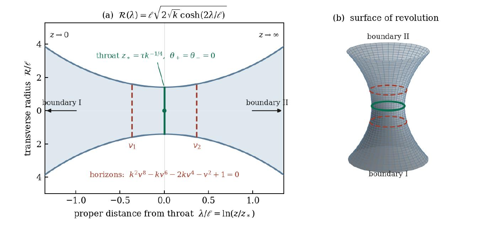
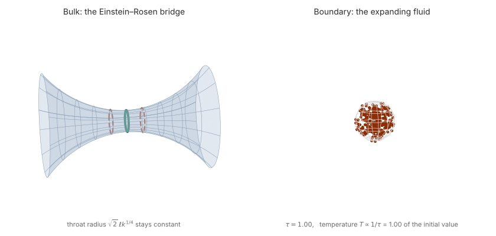

# ER-Bridge

Numerical calculations for "*An Einstein–Rosen bridge in the holographic dual of a spherically expanding fluid*"
(N. Bilić and D. Tolic, in preparation): horizons, throat, extremal surfaces and the area law.



## Usage

```bash
pip install numpy scipy sympy pandas matplotlib
python ER_bridge.py           # all sections; python ER_bridge.py 1 3 7 for selected sections
python area_law_data.py       # data for Fig. 2
python area_law_plot.py       # Fig. 2
python bridge_animation.py    # the animation below
```

## Animation



The fluid on the boundary expands and cools, while the Einstein–Rosen bridge in the bulk stays the same.

## License

MIT
